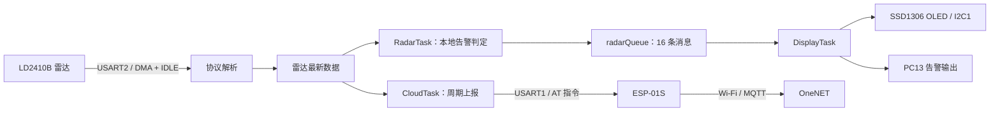

# DeskRadar-IoT

基于 **STM32F103C8T6 + LD2410B 毫米波雷达 + FreeRTOS** 的桌面人体存在检测与安防演示项目。设备通过 OLED 显示目标距离和本地告警状态，并使用 ESP-01S 将检测数据通过 MQTT 上报至 OneNET。

适合用于学习 STM32 外设驱动、UART DMA 接收、FreeRTOS 多任务协作和物联网数据上报。

> 本文依据仓库当前源码整理。当前仓库包含应用代码、HAL 驱动及 FreeRTOS，但缺少 CMake 引用的 `cmake/` 目录；首次构建前请完成下文的工程准备。

## 功能

- **雷达数据采集**：通过 USART2 的 DMA + 空闲线接收获取 LD2410B 数据，解析目标状态、运动/静止目标距离、能量及探测距离。
- **本地告警判定**：对有目标/无目标的数据进行计数累积和衰减，区分安全、疑似、报警三种状态。
- **OLED 显示**：在 SSD1306 128 × 64 屏幕上显示状态和距离；队列等待超时时显示 `Sensor Paused`。
- **GPIO 告警输出**：报警时将 PC13 拉低，安全或疑似状态时置高；可用于常见低电平点亮的板载 LED。
- **云端上报**：通过 ESP-01S 的 MQTT AT 指令，向 OneNET 发送 `distance`、`status` 和 `alarm` 属性。
- **多任务运行**：使用 CMSIS-RTOS2 接口组织雷达、显示和云端任务。

## 系统结构



| 任务 | 优先级 | 职责 |
| --- | --- | --- |
| `RadarTask` | Normal | 初始化雷达接收，处理更新的数据，计算本地安全等级并发送至队列；每轮延时 20 ms |
| `DisplayTask` | BelowNormal | 消费队列数据，更新 OLED 与 PC13 输出；队列接收超时为 100 ms |
| `CloudTask` | Low | 初始化 Wi-Fi/MQTT，读取雷达最新数据并尝试上报；每轮发送后延时 1000 ms |

显示任务使用队列中的判定结果，云端任务直接读取雷达最新数据，因此两者的告警含义有所不同，见下文。

## 硬件与接线

### 硬件清单

- STM32F103C8T6 开发板：工程配置为 72 MHz，链接脚本配置为 64 KB Flash / 20 KB RAM。
- LD2410B 毫米波人体存在检测模块。
- SSD1306 128 × 64 I²C OLED。
- ESP-01S Wi-Fi 模块，需烧录支持 MQTT AT 指令的固件。
- ST-Link 或其他支持 SWD 的下载器。
- 可选 USB 转串口模块，用于 USART3 调试。

### 引脚分配

下表以 STM32 引脚方向为准，串口 TX 与对端 RX 交叉连接。

| 模块 | STM32 引脚 | 连接目标 / 说明 |
| --- | --- | --- |
| ESP-01S | PA9 / USART1_TX | ESP-01S RX |
| ESP-01S | PA10 / USART1_RX | ESP-01S TX |
| LD2410B | PA2 / USART2_TX | 雷达 RX |
| LD2410B | PA3 / USART2_RX | 雷达 TX |
| OLED | PB6 / I2C1_SCL | OLED SCL |
| OLED | PB7 / I2C1_SDA | OLED SDA |
| 调试串口 | PB10 / USART3_TX | USB 转串口 RX，`printf` 输出 |
| 调试串口 | PB11 / USART3_RX | USB 转串口 TX，可选 |
| 告警输出 | PC13 | 低电平表示本地报警，高电平表示安全或疑似 |
| SWD | PA13 / PA14 | SWDIO / SWCLK |

所有模块需要共地。模块供电请按各自规格连接，ESP-01S 使用稳定的 3.3 V 供电；串口信号应与 STM32 的 3.3 V 逻辑兼容。

| 接口 | 当前配置 |
| --- | --- |
| USART1 | 115200 baud，8N1，无硬件流控 |
| USART2 | 256000 baud，8N1，无硬件流控；RX 使用 DMA1 Channel6 |
| USART3 | 115200 baud，8N1，无硬件流控 |
| I2C1 | 400 kHz |
| OLED 地址 | 7 位地址 `0x3C`，传入 HAL 的左移地址为 `0x78` |

## 本地状态判定

状态机位于 [Core/Src/freertos.c](Core/Src/freertos.c) 的 `StartRadarTask()` 中。

每次处理新的雷达数据时：

1. 原始状态 `raw_state > 0`，计数器加 1，上限为 15。
2. 原始状态为 0，计数器减 1，下限为 0。
3. 根据当前计数器更新本地状态：

| 计数器 | 本地状态 | OLED 提示 |
| --- | --- | --- |
| 0 | `SEC_SAFE` | `Status: SAFE` |
| 1～4 | `SEC_SUSPECT` | `Status: LOCKING` |
| 5～15 | `SEC_ALERT` | `! INTRUSION !` |

这是累积与衰减逻辑，无目标数据不会立即清零；阈值按任务实际处理的数据更新次数计算，不是固定的秒数。目标距离用于显示与上报，当前没有按距离阈值划分布防区域。

## OneNET 配置与数据格式

网络代码位于 [Core/Src/esp01s.c](Core/Src/esp01s.c)。

### 配置步骤

1. 为 ESP-01S 准备支持以下指令的 AT 固件：`AT+MQTTUSERCFG`、`AT+MQTTCONN`、`AT+MQTTPUBRAW`。
2. 在 OneNET 创建产品和设备，并配置与下表标识符一致的物模型属性。
3. 在 `ESP01S_Init_Wifi()` 中，将 `AT+CWJAP` 的 SSID、密码替换为自己的 2.4 GHz Wi-Fi 信息。
4. 修改 `AT+MQTTUSERCFG` 中的客户端 ID、用户名与设备 token；具体认证参数以所用 OneNET 产品的接入文档为准。
5. 同步修改 `ESP01S_Post_Data()` 中的产品 ID 和设备名称，保证发布主题与认证设备一致。

代码当前使用 `mqtts.heclouds.com:1883`，发布主题结构为：

```text
$sys/<product_id>/<device_name>/thing/property/post
```

源码当前将 Wi-Fi 和云端认证信息直接写在 AT 指令中。请替换为自己的配置，不要沿用仓库中的密码或 token；此前公开过的有效凭据应更换。本文仅使用占位符，不复述这些值。

### 上报属性

| 标识符 | 值 | 含义 |
| --- | --- | --- |
| `distance` | 整数，单位 cm | 雷达的 `detect_dist` |
| `status` | 0 / 1 / 2 / 3 | LD2410B 原始目标状态：无目标 / 运动 / 静止 / 运动与静止 |
| `alarm` | 0 / 1 | 原始状态为 0 时取 0，大于 0 时取 1 |

示例报文：

```json
{
  "id": "1",
  "version": "1.0",
  "params": {
    "distance": { "value": 120 },
    "status": { "value": 1 },
    "alarm": { "value": 1 }
  }
}
```

**当前云端 `alarm` 表示雷达检测到目标，不等同于本地 `SEC_ALERT` 确认报警。** 云端可能已经上报 `alarm = 1`，而 OLED 仍处于 `LOCKING`。

## 获取、构建与烧录

### 开发环境

- STM32CubeMX：`.ioc` 记录的版本为 6.17.0，STM32Cube FW_F1 为 V1.8.7。
- CMake ≥ 3.22。
- Ninja。
- GNU Arm Embedded Toolchain（`arm-none-eabi-gcc`）；当前链接脚本使用 `READONLY`，建议使用 GCC 11 或更新版本。
- STM32CubeProgrammer 与 ST-Link，用于烧录。

### 获取项目

```bash
git clone https://github.com/Yzsheeep/DeskRadar-IoT.git
cd DeskRadar-IoT
```

### 首次构建前的准备

当前仓库尚不能直接完成全新克隆后的 CMake 构建：

- `CMakeLists.txt` 引用了 `cmake/stm32cubemx`，但仓库没有该目录。
- `CMakePresets.json` 引用了 `cmake/gcc-arm-none-eabi.cmake`，该文件也未提交。
- `.gitignore` 当前忽略整个 `cmake/` 目录。
- `CMakePresets.json` 的 `CMAKE_MAKE_PROGRAM` 固定为原开发环境的 Windows Ninja 路径。

请先备份自定义代码，再用 STM32CubeMX 打开 [DeskRadar-IoT.ioc](DeskRadar-IoT.ioc)，选择 CMake 工程并生成所需构建文件，或从原开发环境补齐上述文件。重新生成后应核对自定义任务、驱动源码和 CMake 配置是否保留。

随后将 `CMAKE_MAKE_PROGRAM` 改为本机 Ninja 路径，或删除该缓存项并将 Ninja 加入 `PATH`；同时确认工具链文件能找到本机的 Arm 编译器。维护仓库时，应将必要的 `cmake/` 构建脚本纳入版本控制。

### 编译

完成上述准备后，在项目根目录执行：

```bash
cmake --preset Debug
cmake --build --preset Debug
```

Release 配置：

```bash
cmake --preset Release
cmake --build --preset Release
```

预设的构建目录分别为 `build/Debug/` 和 `build/Release/`。构建产物名称及 ELF 后缀以补齐后的工具链配置为准。

### 烧录与观察

1. 将下载器连接到 PA13（SWDIO）、PA14（SWCLK）及 GND，并按开发板要求供电。
2. 在 STM32CubeProgrammer 中通过 SWD 连接芯片，选择构建生成的 ELF 文件下载并复位。
3. 检查 OLED 是否显示 `[ SEC SYSTEM ]`，再观察目标靠近和离开时的状态、距离及 PC13 输出。
4. 检查 OneNET 设备是否收到 `distance`、`status`、`alarm` 三项属性。

## 目录说明

```text
DeskRadar-IoT/
├── Core/
│   ├── Inc/                     # 外设与应用头文件
│   └── Src/
│       ├── main.c               # 外设初始化与调度器启动
│       ├── freertos.c           # 任务、队列和本地状态判定
│       ├── radar.c              # LD2410B 协议解析与 DMA 接收
│       ├── esp01s.c             # Wi-Fi / MQTT AT 指令与属性上报
│       ├── oled.c               # SSD1306 显示驱动
│       ├── font.c               # 字库与图标
│       ├── usart.c              # 串口配置与 printf 重定向
│       └── i2c.c                # OLED I2C 配置
├── Drivers/                     # CMSIS 与 STM32 HAL
├── Middlewares/Third_Party/      # FreeRTOS 与 CMSIS-RTOS2 适配
├── DeskRadar-IoT.ioc             # CubeMX 工程配置
├── CMakeLists.txt               # 应用构建入口
├── CMakePresets.json            # Debug / Release 预设
├── STM32F103XX_FLASH.ld          # Flash / RAM 链接布局
└── startup_stm32f103xb.s         # 启动文件
```

## 当前限制与排查

- **网络连接状态**：初始化按固定延时发送 AT 指令，随后直接置位 `g_cloud_online`；该标志不能证明 Wi-Fi 或 MQTT 已连接成功。当前未实现完整的应答校验、断线检测与自动重连。
- **上报时机**：云端任务在每次发送后延时 1000 ms，实际周期还包括串口发送与等待时间。本地首次报警时会设置 `g_need_instant_post`，但云端任务尚未使用该标志，当前没有即时告警上报。
- **发布确认**：发送原始报文前会等待 `>` 提示符，超时则放弃当次发送；当前未验证最终发布结果或处理平台属性上报回执。
- **雷达接收**：当前解析器在单次 DMA 接收缓冲区内查找完整帧，尚未实现跨回调的残帧拼接。若接收事件计数增加但成功解包计数不增加，可检查波特率、接线及数据分帧。
- **屏幕无数据**：`Sensor Paused` 表示显示任务在 100 ms 内未取到队列数据，不一定代表雷达断电。OLED 完全不亮时，检查 PB6/PB7、供电和 I²C 地址。
- **告警输出**：PC13 当前使用固定高低电平，不会闪烁；是否点亮 LED 取决于开发板电路。
- **构建失败**：优先核对缺失的 `cmake/` 文件、Ninja 路径和 Arm 工具链。本文未提供实机测试结果。

## 第三方组件与许可

- STM32 HAL / CMSIS：参见 `Drivers/` 下对应的许可证文件。
- FreeRTOS：参见 [组件许可证](Middlewares/Third_Party/FreeRTOS/Source/LICENSE)。
- OLED 驱动：源码标注来源为波特律动 / keysking，并标注 MIT License；请保留原作者声明。

仓库目前未提供项目级 `LICENSE`。第三方组件按各自许可证使用，项目自有代码的授权范围需由维护者明确。
